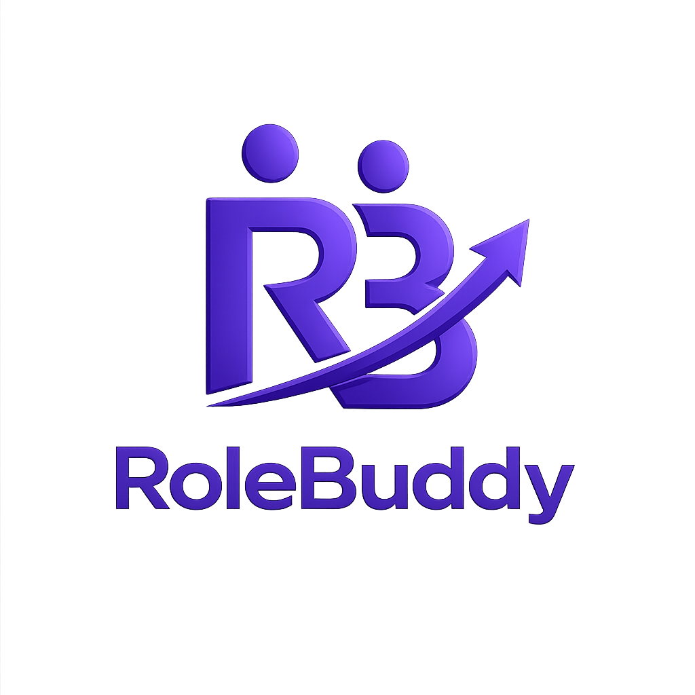

<div align="center">
  
  <br/><br/>
  <strong>Peer Accountability for Job Preparation</strong>
  <br/>
  <a href="https://www.rolebuddy.me">🌐 Live at rolebuddy.me</a> &nbsp;·&nbsp;
  <a href="https://www.rolebuddy.me/signup">Get Started</a> &nbsp;·&nbsp;
  <a href="https://www.rolebuddy.me/login">Log In</a>
  <br/><br/>

  
  
  
  
</div>

---

## What is RoleBuddy?

**RoleBuddy is a role-based peer accountability platform for job preparation.**

It is **not** a content platform. It is **not** a job board. It is **not** a social network.

It is a **consistency system** — built on behavioral design — that:

- Matches you with a peer preparing for the **same job role** (e.g. "Backend Node.js Engineer", "Frontend React Engineer")
- Pairs you 1:1 as accountability partners
- Keeps both of you consistent through **daily check-ins**, **streak tracking**, and **partner visibility**

> *Most job prep fails not because of missing content — but because of isolation and inconsistency.*

---

## The Problem

| Pain Point | What Happens |
|---|---|
| 🧍 **Isolated** | Nobody around you is preparing for the same role. No one to sync with, share progress, or get honest feedback from. |
| 📉 **Inconsistent** | Without external pressure, most people drop off after 3–4 days. The habit never forms and prep restarts from zero. |
| 🔇 **No feedback loop** | You study in silence. No one tells you what to prioritise or holds you accountable day after day. |

---

## How It Works

```
1. Set your role & goals       — pick your target role, experience level, daily study goal, and availability
2. Get matched to a peer       — matching engine finds someone at the same role and level, active in last 24h
3. Daily check-ins in chat     — a system prompt arrives in shared chat every day. Mark done. Partner sees your status.
4. Build your streak           — consecutive done check-ins grow your streak. Breaking it feels costly — that's the point.
5. Peer mock interviews        — run text, live, or video mock interviews directly inside chat
```

---

## Features

### 🔥 Streak Tracking
Consecutive `done` check-ins increment your streak. Skipping a day breaks it. The psychology of loss aversion is the accountability mechanism.

### 🎯 Smart Matching Engine
Hierarchical scoring finds the closest peer first:

| Match Level | Score |
|---|---|
| Same role + experience | 98% |
| Same role | 80% |
| Same specialisation | 62% |
| Same domain area | 41% |
| Fallback (any active user) | — |

Only users active within the last **24 hours** enter the match pool.

### ✅ Daily Check-in System
A system-generated prompt appears in your shared chat every day. You respond `Done` or `Not today`. Your partner sees your status. If you miss your goal, they get an alert message automatically.

### 💬 Real-time + REST Chat
Paired users get a shared conversation. Messages deliver via Socket.IO with REST fallback. Paginated message history, seen state, and realtime delivery.

### ⚡ Experience Exchange System
Share role and interview insights with mutual unlock — **neither partner sees the other's content until both submit**. Fair and reciprocal by design.

What you share:
- **Role Experience** — role, company type, responsibilities, skills, mistakes, advice
- **Interview Experience** — rounds, types, difficulty, notable questions, what you'd change
- **Sensitive Details (mutual opt-in)** — HR contact, referral pathway — unlocked only if both approve

### 🎥 Peer-to-Peer Interviewing System
Practice real interviews with your peer — no third-party tools needed.

| Format | Details |
|---|---|
| **Async Text Interview** | Questions sent over chat, answers at your pace. No need to be online simultaneously. |
| **Live Chat Interview** | Both online at the same time. Rapid-fire text Q&A simulating a real screener. |
| **Live Video Interview** | Face-to-face video call inside the platform. Closest simulation to an actual interview. |

Interview categories: **Technical** (DSA, system design, coding) · **HR** (culture fit, CTC) · **Behavioural** (STAR format, leadership)

### 🌐 Wide Domain Coverage
From technical to non-technical careers — RoleBuddy covers:
- Software Engineering
- Data & AI
- Product & Design
- Marketing & Sales
- Finance & Operations

### 🕵️ Anonymous Display Names
Connect without sharing identity upfront. Names like `swift_phoenix_42` reduce the friction of reaching out to strangers. Trust is built gradually through the accountability loop.

### 🔗 Connection System
Send, accept, or reject connection requests. Suggestions ranked by match score. Discovery shows role-level aggregates — no PII exposed.

---

## Tech Stack

| Layer | Technology |
|---|---|
| **Frontend** | Next.js 15, React 19, TypeScript, Tailwind CSS, PWA |
| **Backend** | Node.js, Express.js, Mongoose |
| **Database** | MongoDB |
| **Realtime** | Socket.IO |
| **Auth** | JWT (HttpOnly cookie + Bearer header fallback) |
| **Deployment** | Docker, GitHub Container Registry (GHCR), GitHub Actions CI/CD |

---

## Repository Structure

```
RoleBuddy/
├── backend/          # Express + MongoDB + Socket.IO API
│   └── src/
│       └── features/ # Feature-based architecture (auth, match, chat, etc.)
├── frontend/         # Next.js 15 app (PWA)
│   └── src/
│       └── app/      # App router pages and components
├── openspec/         # API contracts, database schema, architecture docs
│   ├── config.yaml
│   └── specs/_core/
│       ├── api-reference.md
│       ├── architecture.md
│       └── database-schema.md
├── docs/             # CI/CD, phase documentation
├── .github/          # GitHub Actions workflows
├── docker-compose.yml
└── .env.example
```

---

## Quick Start (Local Development)

### Prerequisites
- Node.js 18+
- npm 9+
- MongoDB instance (local or Atlas)

### 1. Clone the repo
```bash
git clone https://github.com/Himanshuuu-exe/RoleBuddy.git
cd RoleBuddy
```

### 2. Backend Setup
```bash
cd backend
npm install
```

Create `backend/.env`:
```env
MONGO_URI=<your_mongodb_connection_string>
JWT_SECRET=<strong_random_secret>
PORT=5000
CLIENT_ORIGIN=http://localhost:3000
JWT_EXPIRES_IN=7d
JWT_COOKIE_MAX_AGE_MS=604800000
```

Start backend:
```bash
npm run dev
```

### 3. Frontend Setup
```bash
cd frontend
npm install
```

Create `frontend/.env.local`:
```env
NEXT_PUBLIC_API_BASE_URL=http://localhost:5000/api
NEXT_PUBLIC_SOCKET_URL=http://localhost:5000
```

Start frontend:
```bash
npm run dev
```

### App URLs
| Service | URL |
|---|---|
| Frontend | `http://localhost:3000` |
| Backend API | `http://localhost:5000/api` |
| Health check | `http://localhost:5000/health` |

---

## Docker (Optional)

A `docker-compose.yml` is included for local containerised runs.

```bash
# Copy and edit the example overrides
cp docker-compose.override.example.yml docker-compose.override.yml

# Start all services
docker compose up
```

---

## API Overview

Base URL: `http://localhost:5000/api`

| Group | Routes |
|---|---|
| Auth | `POST /api/auth/signup`, `POST /api/auth/login`, `POST /api/auth/logout` |
| User / Onboarding | `GET /api/user/me`, `PUT /api/user/onboarding` |
| Matching | `POST /api/match/trigger`, `GET /api/matches/current` |
| Discovery | `GET /api/discovery/roles`, `GET /api/discovery/users` |
| Connections | `POST /api/connection/request`, `PUT /api/connection/:id/accept` |
| Conversations | `GET /api/conversations`, `POST /api/conversations` |
| Messages | `GET /api/messages/:conversationId`, `POST /api/messages` |
| Accountability | `POST /api/checkin/respond` |

Full endpoint contracts: [`openspec/specs/_core/api-reference.md`](openspec/specs/_core/api-reference.md)

---

## Smoke Tests

Backend:
```bash
cd backend
npm run auth:smoke
npm run onboarding:smoke
npm run matching:smoke
npm run chat:smoke
npm run dashboard:smoke
npm run discovery:smoke
npm run connection:smoke
```

Frontend:
```bash
cd frontend
npm run auth:check
npm run onboarding:check
npm run lint
```

---

## CI/CD

GitHub Actions runs on every pull request and push to `main`:

- ✅ Frontend lint + production build
- ✅ Backend unit checks + API smoke tests
- ✅ Docker image build validation

Images for `main` are published to **GitHub Container Registry (GHCR)**. Staging deploy is manual only.

Reference: [`docs/CI_CD.md`](docs/CI_CD.md)

---

## Security

| Implemented | Planned |
|---|---|
| JWT auth middleware | Rate limiting |
| HttpOnly cookie support | Brute-force protection |
| Bearer token fallback | Expanded trust & safety controls |
| Input validation & error middleware | Session hardening |

---

## Documentation

| Document | Description |
|---|---|
| [`openspec/specs/_core/architecture.md`](openspec/specs/_core/architecture.md) | System design, auth flow, matching flow, socket flow |
| [`openspec/specs/_core/database-schema.md`](openspec/specs/_core/database-schema.md) | All Mongoose models and indexes |
| [`openspec/specs/_core/api-reference.md`](openspec/specs/_core/api-reference.md) | All HTTP endpoints and request/response contracts |
| [`openspec/config.yaml`](openspec/config.yaml) | Tech stack, coding rules, API conventions |
| [`AGENTS.md`](AGENTS.md) | AI agent protocol and codebase rules |
| [`docs/CI_CD.md`](docs/CI_CD.md) | CI/CD setup, secrets, branch protection |

---

## Target Users

**Primary:** Final-year CS/IT students and freshers (0–2 years experience) preparing for tech roles

**Secondary:** Career switchers and early professionals

---

## North Star Metric

> **Weekly active accountability pairs**

The product succeeds only if users return daily. Every feature decision answers: *"Does this improve accountability?"*

---

## Roadmap

### ✅ Phase 1 — Complete
Auth · Onboarding · Matching Engine · Dashboard · Discovery · Connections · Chat (REST + Realtime) · Accountability Mechanics · Activity Tracking · OpenAPI Standardisation

### 🔄 Phase 2 — In Progress
- Trust/safety moderation foundations
- Stronger retention mechanisms
- Observability and production diagnostics
- ADR-based architecture decision log

### 🔮 Future
- Push/email notifications
- AI-powered partner suggestions
- Gamification (badges, streaks leaderboard)
- Mobile app
- Group collaboration (>2 users)

---

<div align="center">
  <sub>Built with ☁️ by <a href="https://github.com/Himanshuuu-exe">Himanshu Chandel</a></sub>
  <br/>
  <sub><a href="https://www.rolebuddy.me">rolebuddy.me</a></sub>
</div>
